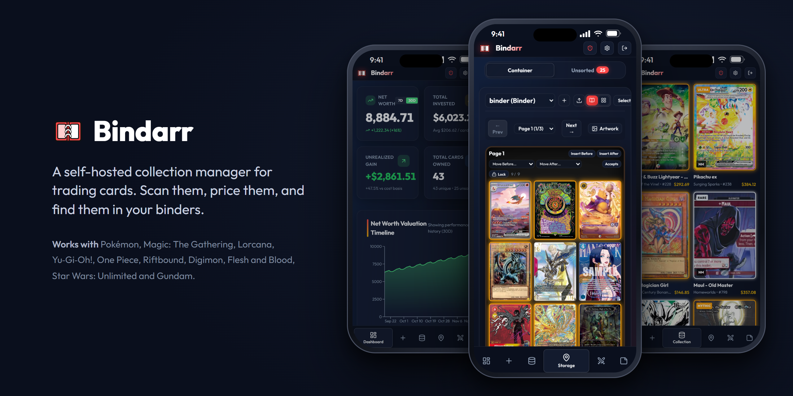

<div align="center">


# Bindarr

**Self-hosted trading card collection manager.**

Scan cards with your phone, track prices, know which binder pocket each card is in, and build decks from what you own.

[](https://github.com/thenotoriousJeremy/bindarr/actions/workflows/test.yml)
[](https://github.com/thenotoriousJeremy/bindarr/pkgs/container/bindarr)
[](LICENSE)

[Live demo](https://thenotoriousjeremy.github.io/bindarr/) · [Install](docs/install.md) · [Docs](#documentation) · [Report a bug](https://github.com/thenotoriousJeremy/bindarr/issues/new)

</div>

---



The [demo](https://thenotoriousjeremy.github.io/bindarr/) runs the real app on sample data. Edits aren't saved and scanning is off.

## Games

Pokémon, Magic: The Gathering, Disney Lorcana, Riftbound, Yu-Gi-Oh!, One Piece, Digimon, Flesh and Blood, Star Wars: Unlimited and the Gundam Card Game.

## Features

- **Camera scanning**: identifies a card from a photo of its artwork, for every game.
- **Storage**: binders by page and pocket, boxes by row and divider. Drag cards into place, or print your own artwork as pocket inserts.
- **Prices and value**: market prices, value trends, set completion, graded slab values, and alerts through Discord, ntfy, Apprise or a webhook.
- **Decks**: build from what you own, check against format rules, and check cards out for play.
- **Lists**: wishlist, buylists and a deck's missing cards, with what the rest would cost.
- **Sealed product**: track boxes and packs unit by unit, and link opened cards to them.
- **Trades and gifts** between accounts on the same server.
- **Cards in 11 languages**, and the app in 11 languages.
- **Multi-user**, with OpenID Connect single sign-on and public share links.
- **Imports and exports**: ManaBox, Moxfield, Archidekt, TCGplayer and Dragon Shield imports; CSV, JSON, full account backups, and a read-only API.
- **Android and iOS apps**, which can also run on their own with no server.

## Quick start

```yaml
# docker-compose.yml
services:
  bindarr:
    image: ghcr.io/thenotoriousjeremy/bindarr:latest
    container_name: bindarr
    restart: unless-stopped
    ports:
      - "3001:3001"   # HTTP, for a reverse proxy
      - "3443:3443"   # HTTPS, needed to scan from a phone without a proxy
    volumes:
      - bindarr-data:/app/database

volumes:
  bindarr-data:
```

```bash
docker compose up -d
docker logs bindarr 2>&1 | grep SETUP   # the one-time setup code
```

Open `http://localhost:3001`, enter the setup code, and create the admin account. To update, run `docker compose pull && docker compose up -d`.

To scan cards, download the scan models and a catalog for each game under **Admin → Catalogs**.

Other ways to run it (prebuilt server binary, mobile apps, building from source) are in [docs/install.md](docs/install.md).

## Documentation

| Page | Covers |
| --- | --- |
| [Install](docs/install.md) | Docker, ports and HTTPS, the server binary, the mobile apps |
| [Configuration](docs/configuration.md) | Environment variables, reverse proxies, single sign-on |
| [Scanning](docs/scanning.md) | Models, catalogs, accuracy |
| [Card data and prices](docs/card-data.md) | Where cards and prices come from, graded values, the TCGCSV mirror |
| [Using Bindarr](docs/using-bindarr.md) | Imports, decks, binders, sealed product, the API |
| [Backups](docs/backups.md) | Automatic backups, restoring, resetting a password |
| [MOBILE.md](MOBILE.md) | The mobile apps and running without a server |
| [PROJECT.md](PROJECT.md) | Architecture and code layout |
| [PRIVACY.md](PRIVACY.md) | Every service Bindarr contacts, and what it sends |

## Contributing

```bash
npm run install:all   # Node 22.12+ (24 recommended, see .nvmrc)
npm run dev           # frontend https://localhost:5173, backend http://localhost:3001
npm test
```

See [CONTRIBUTING.md](CONTRIBUTING.md). Translations need no code: see [docs/TRANSLATING.md](docs/TRANSLATING.md).

## License

[MIT](LICENSE). The scan models are AGPL-3.0 and are downloaded separately.

Bindarr was created under Riot Games' "Legal Jibber Jabber" policy using assets owned by Riot Games. Riot Games does not endorse or sponsor this project.
